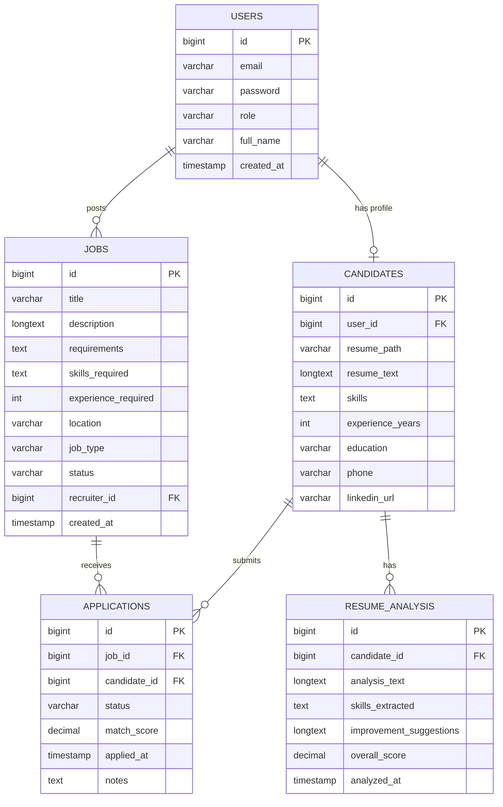

# HireAI - AI-Powered Smart Recruitment & Talent Management System

> An intelligent recruitment platform that leverages Google Gemini AI to streamline hiring, analyze resumes, match candidates to jobs, and generate interview questions — built for the HackQuest hackathon.

---

## 🚀 Tech Stack

| Layer | Technology |
|---|---|
| **Backend** | Java 17, Spring Boot 3.2, Spring Data JPA, Spring Security (JWT) |
| **AI Engine** | Google Gemini API (via REST / RestTemplate) |
| **Database** | MySQL 8+ |
| **Frontend** | React 18, Vite, Tailwind CSS, Axios |
| **Auth** | JWT Bearer Tokens |
| **Build Tools** | Maven, npm |

---

## ✨ Features

### 🤖 AI-Powered Features
1. **Resume Analyzer** – Upload a resume and get a detailed AI analysis: skills extracted, experience level, strengths/weaknesses, and an overall score.
2. **Job–Candidate Matching** – AI scores each candidate against a job description and returns a ranked match percentage with reasoning.
3. **Interview Question Generator** – Generate role-specific, context-aware interview questions based on job requirements and candidate profile.
4. **Resume Improvement Suggestions** – AI provides actionable recommendations to improve a candidate's resume for specific roles.

### 📋 Functional Requirements
- **Authentication** – Register/login for Recruiters and Candidates with role-based access control.
- **Job Management** – Recruiters can create, update, delete, and view job postings.
- **Application Management** – Candidates can apply for jobs; recruiters can view, filter, and update application status.
- **Candidate Profiles** – Candidates maintain profiles with skills, experience, education, and uploaded resumes.
- **Analytics Dashboard** – Recruiters see hiring funnel metrics: total jobs, applications per job, status breakdown.
- **Resume Upload** – PDF/text resume upload with automatic text extraction for AI processing.

---

## 🛠️ Setup Instructions

### Prerequisites
- Java 17+
- Maven 3.8+
- Node.js 18+
- MySQL 8+
- A Google Gemini API Key ([Get one here](https://aistudio.google.com/app/apikey))

### 1. Clone the Repository
```bash
git clone https://github.com/your-org/hack-quest.git
cd hack-quest
```

### 2. Database Setup
```sql
CREATE DATABASE hack_quest_db CHARACTER SET utf8mb4 COLLATE utf8mb4_unicode_ci;
```
Then run the schema (auto-applied by Spring on startup via `schema.sql`).

Optionally seed demo data:
```bash
mysql -u root -p hack_quest_db < seed_data.sql
```

### 3. Backend Setup
```bash
cd backend

# Set your Gemini API key as an environment variable
export GEMINI_API_KEY=your_gemini_api_key_here   # Linux/macOS
set GEMINI_API_KEY=your_gemini_api_key_here       # Windows CMD
$env:GEMINI_API_KEY="your_gemini_api_key_here"    # Windows PowerShell

# Update DB credentials in src/main/resources/application.properties
# (or set DB_HOST, DB_PORT, DB_NAME, DB_USER, DB_PASSWORD env vars)

mvn spring-boot:run
```

Backend will be available at: **http://localhost:8080**

### 4. Frontend Setup
```bash
cd frontend
npm install
npm run dev
```

Frontend will be available at: **http://localhost:5173**

---

## 🔑 Demo Credentials

| Role | Email | Password |
|---|---|---|
| Recruiter | recruiter@demo.com | password123 |
| Recruiter | recruiter2@demo.com | password123 |
| Candidate | candidate@demo.com | password123 |
| Candidate | candidate2@demo.com | password123 |
| Candidate | candidate3@demo.com | password123 |

---

## 📡 API Endpoints

### Auth — `/api/auth`

| Method | Endpoint | Auth | Description |
|---|---|---|---|
| POST | `/api/auth/register` | ❌ | Register a new user (recruiter or candidate) |
| POST | `/api/auth/login` | ❌ | Login and receive a JWT token |
| GET | `/api/auth/me` | ✅ Bearer | Get current authenticated user details |

**Register Body Example:**
```json
{
  "email": "john@example.com",
  "password": "password123",
  "fullName": "John Doe",
  "role": "CANDIDATE"
}
```

**Login Body Example:**
```json
{
  "email": "john@example.com",
  "password": "password123"
}
```

---

### Jobs — `/api/jobs`

| Method | Endpoint | Auth | Description |
|---|---|---|---|
| GET | `/api/jobs` | ❌ | List all active job postings |
| GET | `/api/jobs/{id}` | ❌ | Get a single job by ID |
| POST | `/api/jobs` | ✅ RECRUITER | Create a new job posting |
| PUT | `/api/jobs/{id}` | ✅ RECRUITER | Update a job posting |
| DELETE | `/api/jobs/{id}` | ✅ RECRUITER | Delete a job posting |
| GET | `/api/jobs/my` | ✅ RECRUITER | Get all jobs posted by the current recruiter |

**Create Job Body Example:**
```json
{
  "title": "Senior Software Engineer",
  "description": "We are looking for...",
  "requirements": "5+ years of Java experience...",
  "skillsRequired": "Java, Spring Boot, Microservices",
  "experienceRequired": 5,
  "location": "Remote",
  "jobType": "FULL_TIME"
}
```

---

### Applications — `/api/applications`

| Method | Endpoint | Auth | Description |
|---|---|---|---|
| POST | `/api/applications` | ✅ CANDIDATE | Apply for a job |
| GET | `/api/applications/my` | ✅ CANDIDATE | View my submitted applications |
| GET | `/api/applications/job/{jobId}` | ✅ RECRUITER | View all applications for a job |
| PUT | `/api/applications/{id}/status` | ✅ RECRUITER | Update application status |

**Apply Body Example:**
```json
{
  "jobId": 1
}
```

**Update Status Body Example:**
```json
{
  "status": "INTERVIEW",
  "notes": "Strong candidate, schedule technical round"
}
```

---

### Candidates — `/api/candidates`

| Method | Endpoint | Auth | Description |
|---|---|---|---|
| GET | `/api/candidates/profile` | ✅ CANDIDATE | Get current candidate's profile |
| PUT | `/api/candidates/profile` | ✅ CANDIDATE | Update candidate profile |
| POST | `/api/candidates/upload-resume` | ✅ CANDIDATE | Upload resume file (multipart/form-data) |

**Update Profile Body Example:**
```json
{
  "skills": "Java, Python, React, MySQL",
  "experienceYears": 3,
  "education": "B.Tech Computer Science",
  "phone": "+91-9876543210",
  "linkedinUrl": "https://linkedin.com/in/johndoe"
}
```

---

### AI Features — `/api/ai`

| Method | Endpoint | Auth | Description |
|---|---|---|---|
| POST | `/api/ai/analyze-resume` | ✅ | Analyze resume text with Gemini AI |
| POST | `/api/ai/match-job` | ✅ | Score candidate–job fit with AI |
| POST | `/api/ai/interview-questions` | ✅ | Generate interview questions |
| POST | `/api/ai/improve-resume` | ✅ | Get AI suggestions to improve resume |
| GET | `/api/ai/analysis/{candidateId}` | ✅ | Get stored analysis for a candidate |

**Analyze Resume Body:**
```json
{
  "candidateId": 1
}
```

**Match Job Body:**
```json
{
  "candidateId": 1,
  "jobId": 2
}
```

**Interview Questions Body:**
```json
{
  "jobId": 1,
  "candidateId": 1
}
```

**Improve Resume Body:**
```json
{
  "candidateId": 1,
  "jobId": 1
}
```

---

### Analytics — `/api/analytics`

| Method | Endpoint | Auth | Description |
|---|---|---|---|
| GET | `/api/analytics/dashboard` | ✅ RECRUITER | Get recruiter dashboard metrics |

**Response Example:**
```json
{
  "totalJobs": 5,
  "totalApplications": 23,
  "applicationsByStatus": {
    "APPLIED": 10,
    "SCREENING": 5,
    "INTERVIEW": 5,
    "OFFERED": 2,
    "REJECTED": 1
  },
  "jobsWithApplicationCounts": [...]
}
```

---

## 🗄️ Database ER Diagram



---

## ⚙️ Environment Variables

| Variable | Description | Default |
|---|---|---|
| `GEMINI_API_KEY` | Google Gemini API key (**required**) | — |
| `DB_HOST` | MySQL host | `localhost` |
| `DB_PORT` | MySQL port | `3306` |
| `DB_NAME` | Database name | `hack_quest_db` |
| `DB_USER` | MySQL username | `root` |
| `DB_PASSWORD` | MySQL password | — |
| `VITE_API_URL` | Backend base URL (frontend) | `http://localhost:8080` |

See [`.env.example`](.env.example) for a template.

---

## 📂 Project Structure

```
hack-quest/
├── backend/
│   ├── src/main/java/com/hackquest/recruitment/
│   │   ├── config/          # Security, CORS, JWT config
│   │   ├── controller/      # REST controllers
│   │   ├── dto/             # Request/Response DTOs
│   │   ├── entity/          # JPA entities
│   │   ├── repository/      # Spring Data repositories
│   │   └── service/         # Business logic + AI service
│   └── src/main/resources/
│       ├── application.properties
│       └── schema.sql
├── frontend/
│   ├── src/
│   │   ├── components/      # Reusable UI components
│   │   ├── pages/           # Route pages
│   │   ├── services/        # Axios API calls
│   │   └── context/         # Auth context
│   └── package.json
├── HireAI_Postman_Collection.json
├── seed_data.sql
├── .env.example
├── .gitignore
└── README.md
```

---

## 📄 License

MIT © 2024 HackQuest Team
